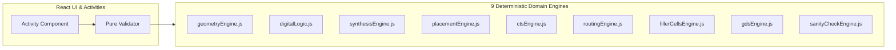

# ASIC Physical Design Playground — Game Engine Specification

This specification documents the pure numerical engines, algorithmic contracts, mathematical equations, inputs, outputs, and deterministic guarantees across all physical design subsystems in PD Playground (`Game-Site`).

---

## 1. Architecture & Design Principles

All physical simulation, geometry calculation, and design rule checks are isolated into pure ES modules located in `src/engine/`.

### Core Engineering Principles
1. **Determinism**: Given identical inputs, every engine function returns identical outputs with zero stochastic jitter.
2. **Side-Effect Free**: Engines do not access the DOM, window globals, or browser `localStorage`.
3. **No Unearned Progression**: Sliders that allow students to manipulate rewards or bypass rules are prohibited. All score awards are computed from genuine geometric, logical, or physical parameters.
4. **Decoupled Verification**: Activities in `src/activities/` render student UI controls and forward state to pure validators in `src/activities/<kingdom>/validators/`, which invoke these domain engines.

---

## 2. Domain Engine Specifications

---

### 2.1 Digital Logic Engine (`src/engine/digitalLogic.js`)

Simulates Register-Transfer Level building blocks, combinational steering, sequential state elements, and finite state machines.

#### Functions
- `evaluateMux2to1(a, b, sel)`:
  - Truth Table: $Y = (\neg \text{sel} \land A) \lor (\text{sel} \land B)$
  - Returns `0` or `1`.
- `evaluateDFF(d, clkEdge, rst_n, qPrev)`:
  - Active-low asynchronous reset: If $\text{rst\_n} = 0 \implies Q = 0$.
  - Rising clock edge: If $\text{clkEdge} = \text{true} \land \text{rst\_n} = 1 \implies Q = D$.
  - Otherwise $Q = Q_{\text{prev}}$.
- `evaluate8BitAdder(a, b, cin)`:
  - Computes 8-bit sum, carry-out ($C_{\text{out}}$), and signed two's complement overflow ($V$):
    $$V = (A_7 \equiv B_7) \land (S_7 \neq A_7)$$
- `evaluateFSM(currentState, inputs)`:
  - Computes next state and outputs for a 4-state Traffic Light Controller (`RED`, `GREEN`, `YELLOW`, `ALL_RED`).

---

### 2.2 Logic Synthesis Engine (`src/engine/synthesisEngine.js`)

Models gate-level netlist translation, Boolean optimization, and technology mapping from generic logic (GTECH) to standard cells.

#### Functions
- `calculateGateDelay(baseDelay, driveStrength, loadCapacitance)`:
  - Linear delay model:
    $$D_{\text{gate}} = D_0 + \frac{R_{\text{drive}}}{\text{size}} \cdot C_{\text{load}}$$
- `estimateDynamicPower(freqHz, vdd, totalCapFarads, activityFactor)`:
  - Switching power equation:
    $$P_{\text{dyn}} = \alpha \cdot C_{\text{total}} \cdot V_{\text{DD}}^2 \cdot f$$
- `checkBooleanEquivalence(exprA, exprB, numInputs)`:
  - Exhaustively compares two Boolean expressions across all $2^N$ input combinations to certify logic optimization correctness without functional degradation.

---

### 2.3 Geometry & Floorplanning Engine (`src/engine/geometryEngine.js`)

Manages die sizing, core boundaries, aspect ratios, I/O pin pitch spacing, macro halo keepouts, and power ring rings.

#### Functions
- `calculateDieDimensions(standardCellArea, macroArea, targetUtilization, aspectRatio)`:
  $$\text{Core Area} = \frac{\text{StdCell Area} + \text{Macro Area}}{U_{\text{target}}}$$
  $$\text{Height} = \sqrt{\frac{\text{Core Area}}{\text{AR}}}, \quad \text{Width} = \text{Height} \cdot \text{AR}$$
- `checkMacroKeepout(macroA, macroB, minHaloSpacing)`:
  - Checks Manhattan keepout distance between hard macros:
    $$\Delta X \ge \text{halo}, \quad \Delta Y \ge \text{halo}$$
- `computePowerRingDrop(sheetResistance, ringWidth, ringLength, peakCurrent)`:
  - Computes DC IR drop along global VDD/VSS distribution rings:
    $$R_{\text{ring}} = R_{\square} \cdot \frac{L_{\text{ring}}}{W_{\text{ring}}}, \quad \Delta V = I_{\text{peak}} \cdot R_{\text{ring}}$$

---

### 2.4 Placement Engine (`src/engine/placementEngine.js`)

Models standard cell site legalization, wirelength optimization, GCell congestion estimation, and well-tap cell insertion rules.

#### Functions
- `legalizeCellToSite(x, y, siteWidth, rowHeight)`:
  - Snaps continuous placement coordinates to integer standard cell sites and rows:
    $$X_{\text{legal}} = \text{round}(X / W_{\text{site}}) \cdot W_{\text{site}}$$
    $$Y_{\text{legal}} = \text{floor}(Y / H_{\text{row}}) \cdot H_{\text{row}}$$
- `computeHPWL(pins)`:
  - Calculates Half-Perimeter Wirelength across multi-terminal nets:
    $$\text{HPWL} = (X_{\max} - X_{\min}) + (Y_{\max} - Y_{\min})$$
- `computeCongestionHeatmap(cells, nets, gridRows, gridCols, binCapacity)`:
  - Derives Global Cell (GCell) routing track demand vs capacity:
    $$\text{Congestion Ratio} = \frac{\text{Tracks Demanded}}{\text{Tracks Available}}$$
- `verifyWellTapPitch(tapLocations, maxAllowedPitch)`:
  - Validates that no N-well diffusion is further than $d_{\max} = 30\,\mu\text{m}$ from a substrate/well tap to eliminate CMOS latch-up susceptibility.

---

### 2.5 Clock Tree Synthesis Engine (`src/engine/ctsEngine.js`)

Calculates clock tree insertion delays, clock skew across register sinks, setup/hold slack consequences, and buffer tree sizing.

#### Functions
- `calculateClockSkew(launchLatency, captureLatency)`:
  $$T_{\text{skew}} = T_{\text{capture}} - T_{\text{launch}}$$
- `calculateSetupSlack(tClk, launchLatency, captureLatency, dataPathDelay, tSetup, tClkQ, jitter)`:
  $$T_{\text{required}} = T_{\text{clk}} + T_{\text{capture}} - T_{\text{setup}} - \text{Jitter}$$
  $$T_{\text{arrival}} = T_{\text{launch}} + T_{\text{clk}\to\text{q}} + T_{\text{datapath}}$$
  $$\text{Setup Slack} = T_{\text{required}} - T_{\text{arrival}}$$
- `calculateHoldSlack(launchLatency, captureLatency, minDataDelay, tHold, tClkQMin)`:
  $$T_{\text{required}} = T_{\text{capture}} + T_{\text{hold}}$$
  $$T_{\text{arrival}} = T_{\text{launch}} + T_{\text{clk}\to\text{q,min}} + T_{\text{data,min}}$$
  $$\text{Hold Slack} = T_{\text{arrival}} - T_{\text{required}}$$
- `simulateClockTreeTopology(topologyType, sinkCount, dieSpan)`:
  - Returns realistic insertion delay, skew variance, and power dissipation for H-Tree, Mesh, and Balanced Buffer Tree architectures.

---

### 2.6 Routing Engine (`src/engine/routingEngine.js`)

Evaluates multi-layer orthogonal metal routing, sheet resistance, Elmore delay, via enclosure rules, and capacitive crosstalk.

#### Functions
- `calculateWireElmoreDelay(lengthUm, widthUm, sheetRes, capPerUm)`:
  $$R_{\text{wire}} = R_{\square} \cdot \frac{L}{W}, \quad C_{\text{wire}} = c_0 \cdot L$$
  $$\tau_{\text{Elmore}} = \frac{1}{2} \cdot R_{\text{wire}} \cdot C_{\text{wire}} + R_{\text{driver}} \cdot C_{\text{wire}}$$
- `checkDRCClearance(metalRectA, metalRectB, layerMinSpacing)`:
  - Validates parallel run length spacing rules and minimum area constraints per metal layer.
- `calculateCrosstalkDelta(couplingCap, groundCap, aggressorSlew, victimDriverStrength)`:
  - Estimates cross-coupling voltage spike and dynamic delay derating:
    $$\Delta V_{\text{victim}} = V_{\text{DD}} \cdot \frac{C_{\text{cross}}}{C_{\text{cross}} + C_{\text{ground}}}$$

---

### 2.7 Filler Cells Engine (`src/engine/fillerCellsEngine.js`)

Validates base-layer physical continuity across standard cell rows, N-well abutment, decap cell dynamic IR droop suppression, and gate leakage power penalties.

#### Functions
- `verifyRowContinuity(placedCells, rowLength)`:
  - Scans standard cell rows to ensure 100% gap-free abutment between active cells and filler cells (FILL1, FILL2, FILL4, FILL8, FILL16, FILL32, FILL64).
- `calculateDecapDroopSuppression(switchingCurrent, pulseDuration, baseGridCap, addedDecap)`:
  - Computes instantaneous power rail droop:
    $$\Delta V_{\text{droop}} = \frac{I_{\text{peak}} \cdot \Delta t}{C_{\text{grid}} + C_{\text{decap}}}$$
- `calculateDecapLeakagePenalty(decapSiteCount, leakagePerSite)`:
  - Models gate oxide tunneling current:
    $$I_{\text{leak}} = N_{\text{sites}} \cdot 0.25\,\mu\text{A}$$

---

### 2.8 GDSII & Tape-Out Engine (`src/engine/gdsEngine.js`)

Validates stream format records, polygon layer mapping (FEOL vs BEOL), antenna ratios, chemical-mechanical polishing (CMP) metal density, and comprehensive sign-off checklists.

#### Functions
- `calculateAntennaRatio(metalArea, gateOxideArea)`:
  $$R_{\text{antenna}} = \frac{\text{Area}_{\text{metal}}}{\text{Area}_{\text{gate}}}$$
  - Rule: If $R_{\text{antenna}} > 200 \implies$ insert reverse-biased diode to bleed charge during plasma etching.
- `verifyCMPDensity(metalArea, windowArea, minAllowed, maxAllowed)`:
  - Density window check:
    $$\rho = \frac{\sum \text{Polygon Areas}}{\text{Window Area}}$$
    - Rule: $0.35 \le \rho \le 0.75$ across all $20\,\mu\text{m} \times 20\,\mu\text{m}$ inspection tiles.
- `validateTapeoutSignoff(drcClean, lvsMatched, staClosed, ercClean, antennaSafe, cmpDensityMet)`:
  - Verifies zero-defect closure before releasing GDSII stream data to the semiconductor foundry.

---

### 2.9 Sanity Check Ruledeck Engine (`src/engine/sanityCheckEngine.js`)

Powers the interactive Physical Design Sanity Check terminals across all stages.
- Executes 26 authentic EDA ruledeck checks.
- Features defect injection drills allowing students to switch between nominal designs and injected physical violations.
- Produces realistic EDA terminal log streams with formatted rule IDs, coordinate locations, and violation metrics.
