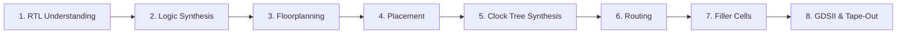

# ASIC Physical Design Playground — Learning Curriculum & Pedagogical Architecture

This document provides the complete curriculum roadmap across all 8 ASIC kingdoms and 40 interactive levels in PD Playground (`Game-Site`).

---

## 1. Curriculum Philosophy & Flow

The PD Playground curriculum is structured around the authentic **ASIC Physical Implementation Pipeline**:

Every level includes:
1. **Engineering Concept & Theory**: High-contrast, readable concept summary explaining the "why".
2. **Interactive EDA Challenge**: Genuine interactive manipulation of circuit truth tables, timing numbers, floorplan dimensions, placement sites, buffer stages, routing tracks, or sign-off checklists.
3. **Pure Deterministic Validation**: Strict feedback on error conditions, partial credit, and full 3-star mastery.
4. **Standalone Studio Cross-Links**: Direct bridges to deep reference laboratories ([RTL Playground](https://ppawar-7.github.io/rtl-playground/) and [STA Playground](https://ppawar-7.github.io/sta-playground/)).

---

## 2. Complete 40-Level Curriculum Breakdown

### Kingdom 1: RTL Understanding (`rtl-understanding`)
*Mirrors: SystemVerilog, Synopsys Design Compiler front-end, Verilator*

| Level | ID | Title | Interactive Activity & Objective | Max XP |
| :---: | :---: | :--- | :--- | :---: |
| 1 | `rtl-1` | What is RTL? | 2:1 MUX complete 8-row truth table, Verilog conditional steering expressions, and data transfer principles. | 30 |
| 2 | `rtl-2` | Signals and Registers | D Flip-Flop with active-low asynchronous reset, clock-edge capture, and register state transitions. | 35 |
| 3 | `rtl-3` | Comb vs Sequential Logic | Propagation delay accumulation through combinational clouds vs clock-period cycle budgeting. | 40 |
| 4 | `rtl-4` | Block Diagram Challenge | 8-bit accumulator datapath, ripple carry, and two's complement signed overflow detection ($V$). | 45 |
| 5 | `rtl-5` | RTL Kingdom Challenge | 4-state Traffic Light Controller Finite State Machine state transition and output decode matrix. | 50 |

---

### Kingdom 2: Logic Synthesis (`synthesis`)
*Mirrors: Synopsys Design Compiler, Cadence Genus, Yosys*

| Level | ID | Title | Interactive Activity & Objective | Max XP |
| :---: | :---: | :--- | :--- | :---: |
| 1 | `syn-1` | What is Synthesis? | GTECH unmapped logic translation, SDC timing constraint definitions, and target `.lib` standard cell libraries. | 30 |
| 2 | `syn-2` | Logic Optimization | Multi-level Boolean minimization, constant propagation, and literal count reduction without functional alteration. | 35 |
| 3 | `syn-3` | Technology Mapping | Mapping generic gates into NAND/NOR/INV standard cells to optimize area-delay Pareto trade-offs. | 40 |
| 4 | `syn-4` | Timing Constraints | Pre-layout setup timing slack calculation: clock period, flip-flop setup times, and combinational gate delays. | 45 |
| 5 | `syn-5` | Synthesis Kingdom Challenge | Capstone multi-constraint synthesis pass optimizing area, delay, and dynamic power dissipation. | 50 |

---

### Kingdom 3: Floorplanning (`floorplanning`)
*Mirrors: Cadence Innovus, Synopsys ICC2 / IC Compiler II*

| Level | ID | Title | Interactive Activity & Objective | Max XP |
| :---: | :---: | :--- | :--- | :---: |
| 1 | `fp-1` | Introduction to Floorplanning | Core vs die boundary concepts, target utilization targets ($60\% - 75\%$), and package cavity constraints. | 30 |
| 2 | `fp-2` | Die Size & Aspect Ratio | Calculating core width and height from standard cell area, macro area, utilization, and aspect ratio ($AR$). | 35 |
| 3 | `fp-3` | I/O Pin Placement | Allocating peripheral I/O pads, bus pin grouping, and minimum pin pitch to minimize core routing congestion. | 40 |
| 4 | `fp-4` | Macro Placement Basics | Placing SRAM macros against core peripheries with orientation alignment and routing halo keepouts. | 45 |
| 5 | `fp-5` | Floorplan Kingdom Challenge | Full floorplan synthesis integrating core aspect ratio, peripheral macro placement, and power ring rings. | 50 |

---

### Kingdom 4: Placement (`placement`)
*Mirrors: Cadence Innovus (place_opt_design), Synopsys ICC2, ePlace*

| Level | ID | Title | Interactive Activity & Objective | Max XP |
| :---: | :---: | :--- | :--- | :---: |
| 1 | `pl-1` | Introduction to Placement | Coarse global placement vs fine legalization; snapping continuous coordinates into discrete standard cell rows. | 30 |
| 2 | `pl-2` | Global vs Detailed Placement | Resolving cell overlaps, maintaining row orientation (N-well abutment), and site snapping. | 35 |
| 3 | `pl-3` | Timing-Driven Placement | Prioritizing critical timing paths by clustering high-fanout driver and receiver cells to minimize delay. | 40 |
| 4 | `pl-4` | Congestion Analysis | Analyzing 2D GCell routing demand heatmaps, locating hotspots, and spreading cells to prevent routing overflows. | 45 |
| 5 | `pl-5` | Placement Kingdom Challenge | Capstone placement pass legalizing cell coordinates while minimizing weighted Half-Perimeter Wirelength (HPWL). | 50 |

---

### Kingdom 5: Clock Tree Synthesis (`cts`)
*Mirrors: Cadence CCOpt, Synopsys CTS, Clock Tree Synthesis Engines*

| Level | ID | Title | Interactive Activity & Objective | Max XP |
| :---: | :---: | :--- | :--- | :---: |
| 1 | `cts-1` | What is CTS? | Clock tree distribution fundamentals: why clocks cannot use standard routing; clock latency vs clock skew. | 30 |
| 2 | `cts-2` | Clock Skew & Latency | Setup and hold slack equations under nonzero clock skew ($T_{\text{skew}} = T_{\text{capture}} - T_{\text{launch}}$) and jitter. | 35 |
| 3 | `cts-3` | Buffer Insertion | Buffer tree insertion to control slew/transition times and equalize insertion delays across distributed sink branches. | 40 |
| 4 | `cts-4` | Clock Tree Topologies | Comparing H-Tree, Clock Mesh, and Balanced Buffer Tree trade-offs across skew, latency, and power. | 45 |
| 5 | `cts-5` | CTS Kingdom Challenge | Capstone clock tree balancing multi-stage buffer networks to meet target skew ($\le 100\,\text{ps}$) and latency. | 50 |

---

### Kingdom 6: Global & Detailed Routing (`routing`)
*Mirrors: Cadence NanoRoute, Synopsys ZRoute, TritonRoute*

| Level | ID | Title | Interactive Activity & Objective | Max XP |
| :---: | :---: | :--- | :--- | :---: |
| 1 | `rt-1` | Introduction to Routing | Multi-layer orthogonal metal routing tracks (horizontal vs vertical), routing grids, and pin access. | 30 |
| 2 | `rt-2` | Metal Layers & Resistivity | Metal layer stack hierarchy: lower thin wires (high resistance) vs upper thick global wires (low resistance). | 35 |
| 3 | `rt-3` | Via and Contact Rules | Via enclosure rules, multi-cut redundant vias for yield, and contact resistance modeling. | 40 |
| 4 | `rt-4` | Signal Integrity & Crosstalk | Cross-coupling capacitance ($C_{\text{cross}}$), dynamic delay variation (Miller effect), and shielding traces. | 45 |
| 5 | `rt-5` | Routing Kingdom Challenge | Detailed routing maze completion obeying track alignment, via enclosures, and zero DRC shorts. | 50 |

---

### Kingdom 7: Filler Cells & Physical Verification (`filler-cells`)
*Mirrors: Cadence Innovus (addFiller), Synopsys ICC2, Physical DRC*

| Level | ID | Title | Interactive Activity & Objective | Max XP |
| :---: | :---: | :--- | :--- | :---: |
| 1 | `fc-1` | Why Filler Cells? | Why empty standard cell row sites cannot be left void: N-well continuity, power rail strapping, and base DRC. | 30 |
| 2 | `fc-2` | Types of Filler Cells | Physical-only standard cell taxonomy: standard non-functional fillers, decap cells, tap cells, and boundary endcaps. | 35 |
| 3 | `fc-3` | N-Well Continuity | Standard cell row gap filling using binary-sized filler cells (FILL1 to FILL64) to ensure unbroken N-well diffusion. | 40 |
| 4 | `fc-4` | Decap Cell Strategy | Decoupling capacitor allocation for dynamic IR droop suppression ($\Delta V = I \cdot \Delta t / C$) vs gate oxide leakage. | 45 |
| 5 | `fc-5` | Filler Cells Kingdom Challenge | Capstone filler cell optimization balancing $100\%$ row fill legality, well continuity, and decap leakage limits. | 50 |

---

### Kingdom 8: GDSII & Tape-Out (`gds`)
*Mirrors: Siemens Calibre (DRC/LVS), Synopsys IC Validator, OASIS/GDSII Stream*

| Level | ID | Title | Interactive Activity & Objective | Max XP |
| :---: | :---: | :--- | :--- | :---: |
| 1 | `gds-1` | What is GDSII? | Industry stream format records, hierarchical cell definitions, polygon boundary types, and OASIS compression. | 30 |
| 2 | `gds-2` | Final Sign-Off Checks | Non-negotiable physical verification gates: Design Rule Checking (DRC), Layout Versus Schematic (LVS), and STA. | 35 |
| 3 | `gds-3` | Layer Stack in GDS | Front-End of Line (FEOL) active diffusion/poly layers vs Back-End of Line (BEOL) metal/via mask mapping. | 40 |
| 4 | `gds-4` | Tape-Out Preparation | Plasma antenna ratio diode protection rules and Chemical-Mechanical Polishing (CMP) dummy metal fill density. | 45 |
| 5 | `gds-5` | Grand Tape-Out Capstone | The final comprehensive ASIC tape-out signoff audit certifying full-flow RTL-to-GDSII closure and foundry release! | 50 |
