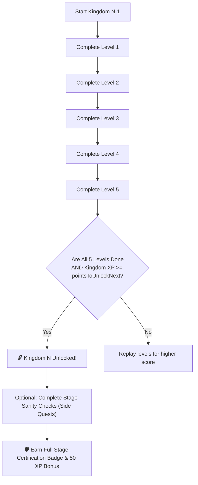

# ASIC Physical Design Playground — Progression Rules & Game Mathematics

This document specifies the exact progression mathematics, unlock prerequisites, scoring rubrics, star thresholds, and achievement conditions across all 8 ASIC Kingdoms.

---

## 1. Kingdom Progression & Unlock Mechanics

The platform consists of 8 sequential ASIC kingdoms representing the complete RTL-to-GDSII flow:

1. **RTL Understanding** (`rtl-understanding`)
2. **Logic Synthesis** (`synthesis`)
3. **Floorplanning** (`floorplanning`)
4. **Placement** (`placement`)
5. **Clock Tree Synthesis** (`cts`)
6. **Global & Detailed Routing** (`routing`)
7. **Filler Cells & Physical Verification** (`filler-cells`)
8. **GDSII & Tape-Out** (`gds`)

### 1.1 Unlocking Kingdom 1
- **Always Unlocked**: `rtl-understanding` is available to all students immediately upon initial launch.

### 1.2 Unlocking Subsequent Kingdoms ($N > 1$)
Kingdom $N$ unlocks if and only if **both** of the following requirements are satisfied in Kingdom $N - 1$:
1. **Core Level Completion**: All 5 core concept levels in Kingdom $N - 1$ must be completed (`completed === true`).
2. **Kingdom XP Threshold**: Total XP earned in Kingdom $N - 1$ must meet or exceed `pointsToUnlockNext`.



> [!NOTE]
> **Decoupled Stage Certification**: Sanity check side quests are **not** hard blockers for unlocking Kingdom $N$. This eliminates progression deadlocks while providing rich side quests for motivated students to earn the "Stage Certified" gold badge and a +50 XP completion bonus.

---

## 2. Kingdom XP Thresholds & Reward Matrix

| Order | Kingdom ID | Name | Core Levels | `pointsToUnlockNext` | Max Level XP | Certifiable Checks | Practice Checks | Certifiable Sanity XP | Kingdom Bonus | Max Total Kingdom XP |
| :---: | :--- | :--- | :---: | :---: | :---: | :---: | :---: | :---: | :---: | :---: |
| 1 | `rtl-understanding` | RTL Understanding | 5 | 140 | 200 | 0 | 0 | 0 | +50 | 250 |
| 2 | `synthesis` | Logic Synthesis | 5 | 140 | 200 | 0 | 0 | 0 | +50 | 250 |
| 3 | `floorplanning` | Floorplanning | 5 | 140 | 200 | 1 | 2 | 25 | +50 | 275 |
| 4 | `placement` | Placement | 5 | 140 | 200 | 3 | 2 | 75 | +50 | 325 |
| 5 | `cts` | Clock Tree Synthesis | 5 | 140 | 200 | 3 | 1 | 75 | +50 | 325 |
| 6 | `routing` | Routing | 5 | 140 | 200 | 3 | 2 | 75 | +50 | 325 |
| 7 | `filler-cells` | Filler Cells | 5 | 140 | 200 | 5 | 4 | 125 | +50 | 375 |
| 8 | `gds` | GDSII & Tape-Out | 5 | 0 | 200 | 0 | 0 | 0 | +50 | 250 |
| **Total** | — | **All 8 Kingdoms** | **40** | — | **1600** | **15** | **11** | **375** | **+400** | **2375 XP** |

---

## 3. Level-by-Level Unlock Gates & Star Mathematics

Each kingdom contains exactly 5 core concept levels.

### 3.1 Unlocking Level $M$ within Kingdom $K$
- **Level 1** ($M = 1$): Unlocked immediately when Kingdom $K$ is unlocked. Requires $0\ \text{XP}$.
- **Subsequent Levels** ($M \in \{2, 3, 4, 5\}$): Unlocked when:
  1. Level $M - 1$ is completed (`player.levelProgress[prevLevelId].completed === true`).
  2. Total XP earned within Kingdom $K$ meets or exceeds Level $M$'s `pointsRequired`.

### 3.2 Calibrated Level Reward Structure & 2-Star Progression Proof

The curriculum uses calibrated score gates to ensure mathematical progression continuity: **any student who earns the lowest acceptable passing score (2 stars) is mathematically guaranteed to unlock the next level and next kingdom without deadlocks or manual replay grinding**.

| Level | Role / Concept Focus | `pointsRequired` | Max `xpReward` | 1-Star Threshold | 2-Star Threshold | 3-Star Threshold | Cumulative 2-Star XP | Next Gate Requirement |
| :---: | :--- | :---: | :---: | :---: | :---: | :---: | :---: | :---: | :---: |
| **Level 1** | Conceptual Foundation & Core Primitive | 0 XP | 30 XP | 10 XP | **20 XP** | 30 XP | 20 XP | 20 XP (Level 2 Unlocks) |
| **Level 2** | Architecture, Formats, & Syntax | 20 XP | 35 XP | 12 XP | **24 XP** | 35 XP | 44 XP | 44 XP (Level 3 Unlocks) |
| **Level 3** | Quantitative Analysis & Trade-Offs | 44 XP | 40 XP | 15 XP | **28 XP** | 40 XP | 72 XP | 72 XP (Level 4 Unlocks) |
| **Level 4** | Advanced Algorithms & DRC Rules | 72 XP | 45 XP | 18 XP | **32 XP** | 45 XP | 104 XP | 104 XP (Level 5 Unlocks) |
| **Level 5** | Capstone Design & Sign-Off Integration | 104 XP | 50 XP | 20 XP | **38 XP** | 50 XP | 142 XP | 140 XP (Kingdom N+1 Unlocks) |

**Mathematical Proof of Progression Continuity:**
1. Completing Level 1 at 2 stars awards $20\ \text{XP} \ge 20\ \text{XP}$ (`pointsRequired` for Level 2). Level 2 unlocks.
2. Completing Level 2 at 2 stars awards $+24\ \text{XP}$, bringing Kingdom XP to $44\ \text{XP} \ge 44\ \text{XP}$ (`pointsRequired` for Level 3). Level 3 unlocks.
3. Completing Level 3 at 2 stars awards $+28\ \text{XP}$, bringing Kingdom XP to $72\ \text{XP} \ge 72\ \text{XP}$ (`pointsRequired` for Level 4). Level 4 unlocks.
4. Completing Level 4 at 2 stars awards $+32\ \text{XP}$, bringing Kingdom XP to $104\ \text{XP} \ge 104\ \text{XP}$ (`pointsRequired` for Level 5). Level 5 unlocks.
5. Completing Level 5 at 2 stars awards $+38\ \text{XP}$, bringing Kingdom XP to $142\ \text{XP} \ge 140\ \text{XP}$ (`pointsToUnlockNext`). The next kingdom unlocks immediately.
6. A student earning maximum mastery (3 stars) accumulates $30 + 35 + 40 + 45 + 50 = 200\ \text{XP}$, exceeding the kingdom unlock threshold by $60\ \text{XP}$. No deadlock is possible under any passing path.

### 3.3 Star Computation Function
```javascript
export function computeStars(score, thresholds) {
  if (score >= thresholds[2]) return 3; // 100% mastery
  if (score >= thresholds[1]) return 2; // Passing standard (>= ~80%)
  if (score >= thresholds[0]) return 1; // Basic completion (>= 50%)
  return 0;                             // Unacceptable / non-passing
}
```

### 3.4 Replay & Score Upgrade Invariant
When a student replays an already completed level:
- New score is evaluated by the pure validator.
- If $\text{New Score} > \text{Previous Best Score}$:
  $$\Delta \text{XP} = \text{New Score} - \text{Previous Best Score}$$
  $$\text{Player Total XP} \leftarrow \text{Player Total XP} + \Delta \text{XP}$$
  $$\text{Level Stars} \leftarrow \max(\text{New Stars}, \text{Previous Stars})$$
- If $\text{New Score} \le \text{Previous Best Score}$, player total XP and stars are **strictly preserved** without downgrade or duplicate reward.

---

## 4. Sanity Check Architecture: Certifiable vs Practice-Only Checks

Across the 5 physical design kingdoms, exactly 26 stage sanity checks are implemented. They fall into two distinct, documented categories:

### 4.1 Exactly 15 Certifiable Stage Checks (`CERTIFIABLE_EDUCATIONAL_CHECK`)
These checks verify genuine, engine-derived layout geometry and physical measurements emitted by student submissions in prerequisite levels.
- **Fail-Closed Verification**: If prerequisite levels are incomplete, or if design artifacts are missing, corrupt, or contain invalid measurements (`NaN`, `Infinity`, negative geometry), the engine **strictly fails closed** with `canCertify: false, passed: false`. No clean fallback defaults are ever substituted.
- **XP Reward**: 25 XP awarded once upon initial certification. Subsequent runs confirm compliance with 0 additional XP.
- **Kingdom Completion Gating**: 100% kingdom completion and the gold Stage Certified badge require completing all 5 concept levels AND certifying all certifiable sanity checks in that kingdom.

### 4.2 Exactly 11 Practice-Only Stage Checks (`PRACTICE_ONLY`)
These checks are dedicated pedagogical demonstration drills and interactive fault-injection sandboxes.
- **Pedagogical Purpose**: Enable students to observe simulated foundry defects, ruledeck diagnostics, and physical failure modes without requiring complex multi-stage layout synthesis.
- **No Progression Blocking**: Practice-only checks unlock when prerequisite levels are done. They are recorded with `drilled: true, score: 0, certified: false` upon drill completion and award **0 certification XP**.
- **Non-Blocking Invariant**: Practice-only checks **never** block kingdom completion or stage certification badges.

### 4.3 Stage Sanity Check Classification Table

| Kingdom | Check ID | Classification | Prerequisite Levels | Verification Focus | Certification XP |
| :--- | :--- | :--- | :--- | :--- | :---: |
| **Floorplanning** | `fp-drc` | `CERTIFIABLE` | `fp-4`, `fp-5` | Core boundary margin & macro halo clearances | 25 XP |
| Floorplanning | `fp-connectivity` | `PRACTICE_ONLY` | `fp-5` | Power ring continuity fault drill | 0 XP |
| Floorplanning | `fp-missing-vias` | `PRACTICE_ONLY` | `fp-5` | Power mesh via intersection drill | 0 XP |
| **Placement** | `pl-legality` | `CERTIFIABLE` | `pl-2`, `pl-5` | Standard cell row site snapping & 0 overlaps | 25 XP |
| Placement | `pl-congestion` | `CERTIFIABLE` | `pl-4` | Peak GCell congestion ratio ($\le 1.0$) | 25 XP |
| Placement | `pl-drc` | `PRACTICE_ONLY` | `pl-5` | Latchup well-tap spacing demonstration drill | 0 XP |
| Placement | `pl-connectivity` | `PRACTICE_ONLY` | `pl-5` | Netlist pin binding demonstration drill | 0 XP |
| Placement | `pl-missing-vias` | `CERTIFIABLE` | `pl-5` | Cell power pin rail snap & 0 off-rail cells | 25 XP |
| **CTS** | `cts-clock-tree-report` | `CERTIFIABLE` | `cts-5` | Clock arrival skew balance ($\le 50$ ps) | 25 XP |
| CTS | `cts-timing-reports` | `CERTIFIABLE` | `cts-2` | Post-CTS setup & hold timing closure | 25 XP |
| CTS | `cts-power` | `CERTIFIABLE` | `cts-3`, `cts-5` | Clock buffer switching dissipation ($\le 5.0$ mW) | 25 XP |
| CTS | `cts-qor` | `PRACTICE_ONLY` | `cts-5` | Max clock slew transition drill | 0 XP |
| **Routing** | `rt-lvs` | `CERTIFIABLE` | `rt-5` | Detailed route LVS netlist match & 0 shorts | 25 XP |
| Routing | `rt-design` | `CERTIFIABLE` | `rt-3` | Via enclosure ($\ge 0.010$ µm) & DRC pitch rules | 25 XP |
| Routing | `rt-constraints` | `CERTIFIABLE` | `rt-4` | Signal integrity crosstalk glitch noise ($\le 50$ mV) | 25 XP |
| Routing | `rt-routes` | `PRACTICE_ONLY` | `rt-5` | Open net track continuity drill | 0 XP |
| Routing | `rt-timing` | `PRACTICE_ONLY` | `rt-5` | Post-route SPEF RC timing slack drill | 0 XP |
| **Filler Cells** | `fc-legality` | `CERTIFIABLE` | `fc-5` | 100% standard cell row discrete fill ratio | 25 XP |
| Filler Cells | `fc-drc` | `CERTIFIABLE` | `fc-5` | Base layer poly & diffusion notch DRC | 25 XP |
| Filler Cells | `fc-connectivity` | `CERTIFIABLE` | `fc-3` | Continuous N-well & substrate bias | 25 XP |
| Filler Cells | `fc-constraints` | `CERTIFIABLE` | `fc-4` | Dynamic power rail droop suppression ($\le 40$ mV) | 25 XP |
| Filler Cells | `fc-power` | `CERTIFIABLE` | `fc-4` | Decap gate oxide tunneling leakage ($\le 20\ \mu\text{A}$) | 25 XP |
| Filler Cells | `fc-design` | `PRACTICE_ONLY` | `fc-5` | Row endcap and tap boundary drill | 0 XP |
| Filler Cells | `fc-timing` | `PRACTICE_ONLY` | `fc-5` | Filler parasitic interconnect impact drill | 0 XP |
| Filler Cells | `fc-qor` | `PRACTICE_ONLY` | `fc-5` | Composite filler quality of results scorecard | 0 XP |
| Filler Cells | `fc-congestion` | `PRACTICE_ONLY` | `fc-5` | Pin blockage & upper routing track availability | 0 XP |

---

## 5. Player Ranks & Achievement Triggers

### 5.1 Player Levels (Title Progression)
| Player Level | Title | Required Total XP |
| :---: | :--- | :---: |
| 1 | Circuit Novice | 0 XP |
| 2 | Gate Guardian | 50 XP |
| 3 | RTL Rider | 150 XP |
| 4 | Synthesis Sage | 300 XP |
| 5 | Floor Architect | 500 XP |
| 6 | Placement Pro | 750 XP |
| 7 | Clock Keeper | 1050 XP |
| 8 | Route Master | 1400 XP |
| 9 | Filler Wizard | 1800 XP |
| 10 | Tape-Out Legend | 2250 XP |
| 11 | ASIC Grandmaster | 2600 XP |

### 5.2 Achievements

| Achievement ID | Name | Description | Trigger Condition |
| :--- | :--- | :--- | :--- |
| `first-level` | First Silicon Step | Complete your very first level | $\ge 1$ level completed |
| `truth-table-master` | Truth Table Master | Master all 8 rows of the 2:1 MUX | `rtl-1` completed with 3 stars |
| `rtl-master` | RTL Grand Architect | Complete all levels of RTL Kingdom | All 5 RTL levels completed |
| `syn-master` | Logic Synthesis Master | Complete all levels of Synthesis Kingdom | All 5 Synthesis levels completed |
| `fp-master` | Floorplan Architect | Complete all levels of Floorplanning | All 5 Floorplanning levels completed |
| `pl-master` | Legal Placement Pro | Complete all levels of Placement | All 5 Placement levels completed |
| `cts-master` | Clock Tree Virtuoso | Complete all levels of CTS | All 5 CTS levels completed |
| `rt-master` | Route Mastermind | Complete all levels of Routing | All 5 Routing levels completed |
| `fc-master` | Physical Integrity Guardian | Complete all levels of Filler Cells | All 5 Filler Cells levels completed |
| `gds-master` | Tape-Out Champion | Complete all levels of GDSII Kingdom | All 5 GDS levels completed |
| `grandmaster` | ASIC Grandmaster | Complete all 8 kingdoms across the flow | All 8 kingdoms completed |

---

## 6. Replay Delta Scoring Formula & Certification Stale Handling

When a student replays an activity:
$$\Delta \text{XP} = \max(0, \text{NewScore} - \text{PreviouslyRecordedXP})$$

1. **XP Delta**: Total player XP increases only by $\Delta \text{XP}$, preventing artificial XP grinding while fully rewarding genuine engineering optimization.
2. **Clean Artifact Envelope Replacement**: Replaying an activity completely replaces its stored artifact envelope with new deterministic measurements derived from the student's submission.
3. **Stale Certification Detection**: If a student replays a level and submits a design that violates a previously certified check's constraints, the certification engine detects this and transitions the certification to `stale: true, certified: false`, requiring the student to re-verify compliance before re-earning the certification.
4. **No Double-Dipping**: Re-certifying a revalidated check confirms compliance with $0\text{ additional XP}$ (the $25\text{ XP}$ was already awarded previously).
