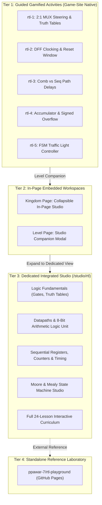

# ASIC Physical Design Playground — RTL Studio Native Integration Architecture

This document details the architectural integration between **Game-Site** (the central gamified educational platform) and the standalone **RTL Playground** (`ppawar-7/rtl-playground`).

---

## 1. Architectural Model: 4-Tier Integration Hierarchy

Rather than treating the standalone RTL laboratory as merely an outbound web link or hastily duplicating its features, PD Playground implements a **4-tier integration model**:

---

## 2. The Four Integration Tiers Defined

### Tier 1: Guided Introductory Curriculum
- **Location**: `src/activities/rtl/` (`rtl-1` to `rtl-5`)
- **Role**: Structured, deterministic, automatically validated challenges.
- **Mastery Gating**: Every level recomputes score and star criteria using pure mathematical functions (`digitalLogic.js`). Evaluates complete truth tables, setup time violations, signed overflow detection ($V = (A_7 \equiv B_7) \land (S_7 \neq A_7)$), and state transition coverage.
- **Persistence**: Successful completions award XP and unlock downstream synthesis and physical design kingdoms.

### Tier 2: In-Page Embedded Studio Workspaces
- **Location**: `src/pages/KingdomPage/KingdomPage.jsx` and `src/pages/LevelPage/LevelPage.jsx`
- **Role**: Immediate hands-on exploration without navigating away from the current lesson.
- **Implementation**: The RTL Kingdom page features an inline laboratory workspace (`Open In-Page Studio`), and each level provides a `Studio Companion` modal mounting `/studios/rtl/index.html`.

### Tier 3: Dedicated Integrated Studio Route
- **Location**: `src/pages/StudioPage/RTLStudioPage.jsx` (Route: `/studio/rtl`)
- **Role**: Full-screen, comprehensive engineering studio environment.
- **Features**:
  - Embedded iframe running the complete client-side RTL Playground bundle served locally from `public/studios/rtl/index.html`.
  - Tab controls for:
    1. 🔌 **Logic Fundamentals**: Primitive gates, multi-input boolean synthesis, truth tables.
    2. 🧮 **Datapaths & 8-Bit ALU**: Arithmetic logic units, adders, bitwise operations.
    3. ⏱️ **Registers & Counters**: Clocked sequential logic, ring counters, setup/hold constraints.
    4. 🔄 **FSM Studio**: State transition graphs, bubble diagrams, Moore/Mealy outputs.
    5. 📚 **24-Lesson Curriculum**: Structured digital logic sequence from transistor physics to CPUs.
  - **Zero Network Latency**: Runs 100% locally with zero cloud or API dependencies.

### Tier 4: External Standalone Repository
- **Location**: `https://ppawar-7.github.io/rtl-playground/` (`ppawar-7/rtl-playground`)
- **Role**: Independent open-source laboratory repository.
- **Preservation Guarantee**: Standalone development continues independently without regression or code disruption from Game-Site.

---

## 3. Curriculum Mapping: Game-Site Levels to RTL Playground Lessons

| Game-Site Level | Activity Focus | Key Educational Objective | Standalone RTL Studio Equivalent Lessons |
| :--- | :--- | :--- | :--- |
| **`rtl-1`**: What is RTL? | 2:1 Multiplexer Truth Table & Verilog Ternary Operator | Teaches how combinational expressions (`assign Y = sel ? B : A;`) steer data between registers without implying every conditional creates a physical MUX. | **Lesson 1–4**: Basic Gates, Truth Tables, Multiplexers |
| **`rtl-2`**: Signals & Registers | D Flip-Flop with Active-Low Asynchronous Reset | Examines register storage, clock-edge sensitivity, setup time windows, and register reset recovery. | **Lesson 7–9**: Flip-Flops, Latches, Clock Gating |
| **`rtl-3`**: Comb vs Sequential | Path Delay Analysis & Clock Period Gating | Explores propagation delay summation through combinational clouds and critical path timing closure ($T_{\text{clk}} \ge T_{\text{clk}\to\text{q}} + T_{\text{comb}} + T_{\text{setup}}$). | **Lesson 10–12**: Clock Periods, Slack, Timing Graphs |
| **`rtl-4`**: Datapath & Arithmetic | 8-Bit Adder/Accumulator & Signed Overflow Flag | Calculates multi-bit two's complement arithmetic and computes signed overflow detection ($V = (A_7 \equiv B_7) \land (S_7 \neq A_7)$). | **Lesson 13–16**: Adders, ALUs, Bitwise Datapaths |
| **`rtl-5`**: Control Logic & FSM | 4-State Traffic Light FSM Controller | Implements sequential state registers, next-state decode logic, output state vectors, and prevents illegal state lockup. | **Lesson 17–20**: Finite State Machines, Moore/Mealy Models |

---

## 4. Offline Delivery & Security Architecture

1. **Local Static Assets**:
   - The compiled RTL Playground static assets are packaged directly into `public/studios/rtl/`.
   - Served by Vite at `/studios/rtl/index.html`.
2. **Iframe Isolation**:
   - Embedded with `sandbox="allow-scripts allow-same-origin allow-forms allow-modals"`.
   - Prevents untrusted scripts from altering parent React application state while allowing rich canvas rendering and waveform playback.
3. **No External Network Requests**:
   - The studio bundle operates entirely on in-browser Web APIs with zero tracking or telemetry.

---

## 5. 100% Offline Asset Delivery & Font Isolation

All RTL Playground assets (interactive simulator, logic gate schematics, waveform canvas, and Moore/Mealy FSM builder) are hosted strictly locally under `public/studios/rtl/`. The standalone HTML and scripts use local system font stacks (`-apple-system, BlinkMacSystemFont, "Segoe UI", Roboto, sans-serif`) with zero external network requests to Google Fonts or cloud CDNs.
