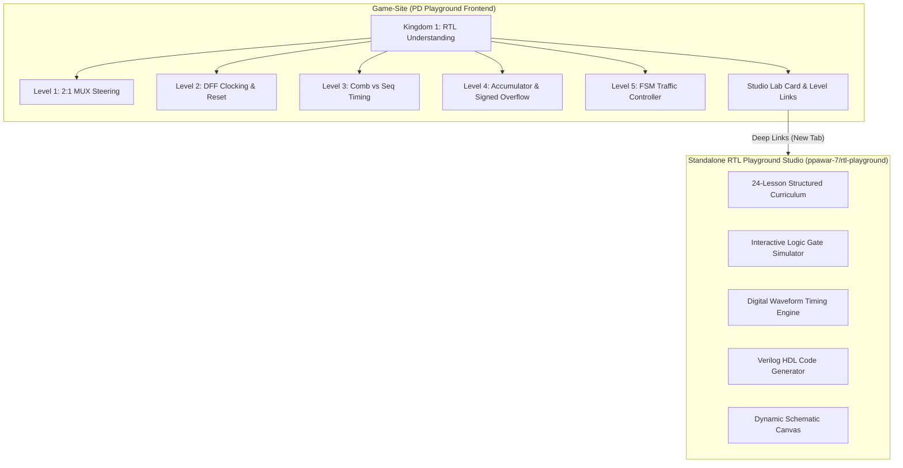

# ASIC Physical Design Playground — RTL Integration & Standalone Studio Bridge

This document details the architectural integration between **Game-Site** (the central gamified educational frontend) and the standalone **RTL Playground** (`https://ppawar-7.github.io/rtl-playground/`).

---

## 1. Architectural Relationship

---

## 2. Core Principles of the Integration

1. **Preserve Standalone Projects**:
   - Game-Site does **not** reimplement the entire 24-lesson RTL studio or heavy waveform synthesizer inside React.
   - The standalone `ppawar-7/rtl-playground` repository remains the authoritative reference laboratory for open-ended circuit design, full schematic capture, waveform visualization, and Verilog generation.

2. **Game-Site's Dedicated Role**:
   - Game-Site serves as the **introductory assessment and gamified gating platform**.
   - It provides lightweight, high-yield, interactive challenges designed for fast browser execution and objective automated grading.
   - It records student XP, awards stars, certifies foundational digital logic mastery, and gates progression to Kingdom 2 (Logic Synthesis).

3. **Seamless Studio Lab Bridge**:
   - The RTL Kingdom page prominently features a **Full Standalone RTL Playground Suite** card with an outbound action button (`Open RTL Studio Lab ↗`) linking directly to `https://ppawar-7.github.io/rtl-playground/`.
   - Every RTL level page includes a dedicated bridge link allowing students to launch the full studio simulator when they want open-ended experimentation.

---

## 3. Curriculum Mapping: Game-Site Levels to RTL Playground Lessons

| Game-Site Level | Activity Focus | Key Educational Objective | Standalone RTL Studio Equivalent Lessons |
| :--- | :--- | :--- | :--- |
| **`rtl-1`**: What is RTL? | 2:1 Multiplexer Truth Table & Verilog Ternary Operator | Teaches how combinational expressions (`assign Y = sel ? B : A;`) steer data between registers without implying every conditional creates a physical MUX. | **Lesson 1–4**: Basic Gates, Truth Tables, Multiplexers |
| **`rtl-2`**: Signals & Registers | D Flip-Flop with Active-Low Asynchronous Reset | Examines register storage, clock-edge sensitivity, setup time windows, and register reset recovery. | **Lesson 7–9**: Flip-Flops, Latches, Clock Gating |
| **`rtl-3`**: Comb vs Sequential | Path Delay Analysis & Clock Period Gating | Explores propagation delay summation through combinational clouds and critical path timing closure ($T_{\text{clk}} \ge T_{\text{clk}\to\text{q}} + T_{\text{comb}} + T_{\text{setup}}$). | **Lesson 10–12**: Clock Periods, Slack, Timing Graphs |
| **`rtl-4`**: Datapath Challenge | 8-Bit Accumulator with Signed Overflow Detection | Tests datapath register accumulation, two's complement arithmetic, and hardware overflow condition $V = (A_7 \equiv B_7) \land (S_7 \neq A_7)$. | **Lesson 14–17**: Arithmetic Logic Units (ALUs), Adders |
| **`rtl-5`**: RTL Kingdom Challenge | 4-State Traffic Light Controller FSM | Synthesizes state transitions, next-state logic, and output decode matrices for finite state machines. | **Lesson 19–24**: Moore & Mealy State Machines, Verilog FSM Coding |

---

## 4. Verification and Automated Grading Contract

Every RTL level in Game-Site executes against an isolated, pure mathematical validator:
- `validateMuxChallenge.js`
- `validateDFFChallenge.js`
- `validateCombSeqChallenge.js`
- `validateAccumulatorChallenge.js`
- `validateFSMChallenge.js`

### Grading Rules
- Input validation verifies that all required table entries, pin assignments, or logic state transitions are selected before evaluating correctness.
- Formative feedback pinpoints exact failing rows or invalid transitions.
- Scores $\ge 24\ \text{XP}$ award **2 Stars** and satisfy the prerequisite to unlock subsequent levels and synthesis.
- Perfect solutions award **3 Stars** (up to 50 XP).
