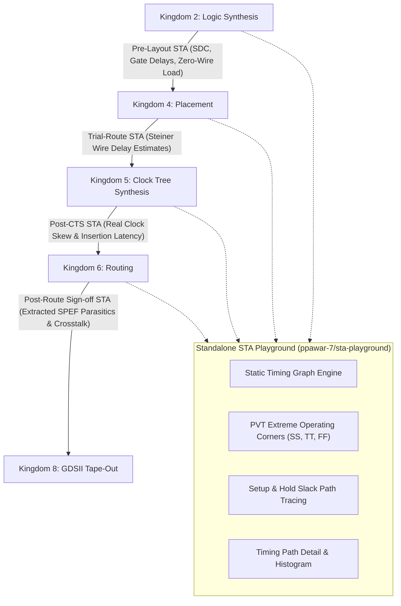

# ASIC Physical Design Playground — Static Timing Analysis (STA) Integration

This document defines the architectural integration between **Game-Site** and the standalone **STA Playground** (`https://ppawar-7.github.io/sta-playground/`), with strict engineering disambiguation between Static Timing Analysis (STA) and Clock Tree Synthesis (CTS).

---

## 1. Fundamental Engineering Distinction: STA vs CTS

A critical tenet of ASIC physical design pedagogy in PD Playground is the proper separation of analysis from implementation:

> [!IMPORTANT]
> **STA is NOT CTS.**
> - **Clock Tree Synthesis (CTS)** is an **implementation process**. It physically builds the clock distribution network — placing clock buffers, sizing inverters, constructing balanced tree or mesh topologies, and equalizing wirelengths to deliver clock edges to tens of thousands of sequential sinks with minimal skew and insertion latency.
> - **Static Timing Analysis (STA)** is a **verification process**. It evaluates timing graphs across all paths in the netlist, checks setup and hold constraints under Process-Voltage-Temperature (PVT) operating corners, and reports positive or negative slacks. STA does **not** insert clock buffers or synthesize trees.

---

## 2. STA Across the ASIC Physical Design Flow

STA is not confined to a single stage; it is an ongoing sign-off gate across four key kingdoms:

### Stage-by-Stage STA Role

1. **Synthesis (Pre-Layout STA)**:
   - Validates SDC clock period constraints ($T_{\text{period}}$), input arrival delays, and output required delays.
   - Computes gate delays using standard cell library models (`.lib`) assuming ideal clock distribution and estimated wireload models.

2. **Placement (Trial-Route STA)**:
   - Uses legalized cell coordinates to calculate Half-Perimeter Wirelength (HPWL) and FLUTE Steiner trees.
   - Evaluates estimated interconnect delays ($R \cdot C$) to guide placement density and fix high-capacitance fanout violations before building the clock tree.

3. **CTS (Post-CTS STA)**:
   - Evaluates timing margins with **actual physical clock propagation delay**.
   - Propagated clocks replace ideal clock assertions.
   - Analyzes how positive or negative clock skew ($T_{\text{skew}} = T_{\text{capture}} - T_{\text{launch}}$) directly affects setup vs hold margins:
     $$\text{Setup Slack} = T_{\text{clk}} + T_{\text{skew}} - T_{\text{datapath}} - T_{\text{setup}}$$
     $$\text{Hold Slack} = T_{\text{datapath}} - T_{\text{skew}} - T_{\text{hold}}$$
   - Reveals the fundamental tradeoff: Positive skew helps setup margin but penalizes hold margin!

4. **Routing (Post-Route Sign-off STA)**:
   - Replaces Steiner wire estimations with true 3D parasitic extraction (SPEF) from detailed routing geometry.
   - Evaluates cross-coupling Miller capacitance ($C_{\text{cross}}$) for signal integrity (SI) dynamic delay pushout and noise glitch analysis.

---

## 3. Standalone Lab Integration & Deep Links

Game-Site integrates the standalone **STA Playground** (`ppawar-7/sta-playground`) as an external interactive laboratory:
- **Kingdom Page Cards**: Displayed prominently in Synthesis, Placement, CTS, and Routing kingdoms with targeted descriptions explaining STA's role at that specific stage.
- **Level Page Bridge Link**: Displayed at the bottom of timing levels, inviting students to trace complete multi-corner graphs in the standalone studio.
- **Direct Link**: `https://ppawar-7.github.io/sta-playground/` opens in a separate browser tab, preserving the student's Game-Site session and progress.

---

## 4. Game-Site's Native Timing Challenges

While STA Playground handles full-path graph traversal, Game-Site features native, mathematically rigorous timing exercises:
- `syn-4`: Pre-layout setup slack calculation given clock period, cell delays, and flip-flop setup times.
- `cts-1`: Clock skew and latency fundamentals; understanding launch vs capture arrival times.
- `cts-2`: Quantitative setup and hold slack closure with nonzero clock skew and jitter.
- `rt-4`: Signal integrity, wire coupling capacitance, and buffer insertion for slew control.
- `gds-2`: Multi-corner sign-off auditing (ensuring both Setup WNS $\ge 0$ at Slow-Slow corner and Hold WNS $\ge 0$ at Fast-Fast corner).
