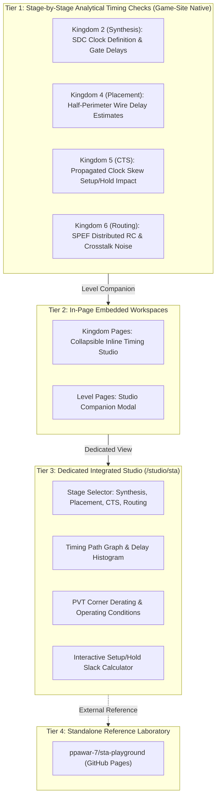

# ASIC Physical Design Playground — Static Timing Analysis (STA) Studio Native Integration Architecture

This document defines the architectural integration between **Game-Site** and the standalone **STA Playground** (`ppawar-7/sta-playground`), including strict engineering disambiguation between Static Timing Analysis (STA) and Clock Tree Synthesis (CTS).

---

## 1. Fundamental Engineering Distinction: STA vs CTS

A critical tenet of ASIC physical design pedagogy in PD Playground is the unambiguous separation of analysis from implementation:

> [!IMPORTANT]
> **STA is NOT CTS.**
> - **Clock Tree Synthesis (CTS)** is an **implementation process**. It physically builds the clock distribution network — placing clock buffers, sizing inverters, constructing balanced tree or mesh topologies, and equalizing wirelengths to deliver clock edges to tens of thousands of sequential sinks with minimal skew and insertion latency.
> - **Static Timing Analysis (STA)** is a **verification process**. It evaluates timing graphs across all paths in the netlist, checks setup and hold constraints under Process-Voltage-Temperature (PVT) operating corners, and reports positive or negative slacks. STA does **not** insert clock buffers or synthesize trees.

---

## 2. Architectural Model: 4-Tier Integration Hierarchy

PD Playground implements a **4-tier integration model** for Static Timing Analysis:

---

## 3. The Four Integration Tiers Defined

### Tier 1: Stage-by-Stage Analytical Timing Checks
- **Location**: Evaluated inside curriculum activities and verified by `src/engine/ctsEngine.js` and `src/engine/sanityCheckEngine.js`.
- **Role**: Lightweight, deterministic timing calculations embedded within level activities:
  - Synthesis: $T_{\text{clk}} \ge T_{\text{clk}\to\text{q}} + T_{\text{comb}} + T_{\text{setup}}$
  - Placement: Wire capacitance and FLUTE Steiner estimation.
  - CTS: Setup slack with real clock skew ($T_{\text{skew}} = T_{\text{capture}} - T_{\text{launch}}$):
    $$\text{Slack}_{\text{setup}} = T_{\text{clk}} + T_{\text{skew}} - T_{\text{comb}} - T_{\text{setup}} - T_{\text{cq}}$$
    $$\text{Slack}_{\text{hold}} = T_{\text{comb}} + T_{\text{cq}} - T_{\text{skew}} - T_{\text{hold}}$$
  - Routing: Elmore delay $\tau = \sum R_i \cdot C_i$ and SPEF extraction.

### Tier 2: In-Page Embedded Studio Workspaces
- **Location**: `src/pages/KingdomPage/KingdomPage.jsx` and `src/pages/LevelPage/LevelPage.jsx`
- **Role**: Immediate visual access to the timing graph analyzer directly on Synthesis, Placement, CTS, and Routing pages without context switching.

### Tier 3: Dedicated Integrated Studio Route
- **Location**: `src/pages/StudioPage/STAStudioPage.jsx` (Route: `/studio/sta`)
- **Role**: Full-screen, deep-dive Static Timing Analysis laboratory.
- **Features**:
  - Embedded iframe running the complete STA Playground React application served locally from `public/studios/sta/index.html`.
  - Stage context selector buttons:
    1. ⚙️ **Synthesis**: Pre-layout timing, ideal clock assertions, library cell delays.
    2. 📍 **Placement**: Trial-route wire delays, cell density impact.
    3. 🌳 **Clock Tree Synthesis**: Propagated clock networks, skew injection, arrival latency.
    4. 🛣️ **Routing**: Post-route SPEF parasitics, crosstalk glitch noise.
  - Prominent architectural note detailing the engineering boundary between CTS and STA.
  - **Zero Network Latency**: 100% locally hosted and functional offline.

### Tier 4: External Standalone Repository
- **Location**: `https://ppawar-7.github.io/sta-playground/` (`ppawar-7/sta-playground`)
- **Role**: Independent open-source repository. Development and specialized algorithms in the standalone project remain preserved and uncompromised.

---

## 4. Stage-by-Stage Educational STA Matrix

| ASIC Stage | Clock Model | Interconnect Model | Key Timing Equations & Verification Focus |
| :--- | :--- | :--- | :--- |
| **Logic Synthesis** | Ideal (0 ps skew, 0 ps latency) | Estimated fanout wireload | $T_{\text{clk}} \ge T_{\text{comb}} + T_{\text{setup}} + T_{\text{cq}}$. Validates cell drive strength and logic depth. |
| **Placement** | Ideal | Estimated Steiner HPWL | Pin-to-pin RC delays. Validates cell legalization without critical path stretching. |
| **Clock Tree Synthesis (CTS)** | Propagated (physical skew) | Steiner / early global routes | Setup vs hold tradeoff under skew: $\text{Slack}_{\text{setup}} = T_{\text{clk}} + T_{\text{skew}} - T_{\text{data}} - T_{\text{setup}}$. Hold: $\text{Slack}_{\text{hold}} = T_{\text{data}} - T_{\text{skew}} - T_{\text{hold}}$. |
| **Global & Detailed Routing** | Propagated | Extracted SPEF ($R, C$) | Detailed wire parasitics, crosstalk delta-delay, and sign-off timing closure across SS/TT/FF corners. |

---

## 5. Offline Packaging & Isolation

1. **Local Static Bundle**:
   - Packaged directly into `public/studios/sta/` from `pd-playground-sta/dist`.
   - Served cleanly at `/studios/sta/index.html` by Vite.
2. **Iframe Isolation**:
   - Configured with `sandbox="allow-scripts allow-same-origin allow-forms allow-modals"`.
   - Completely offline with zero external network calls.
