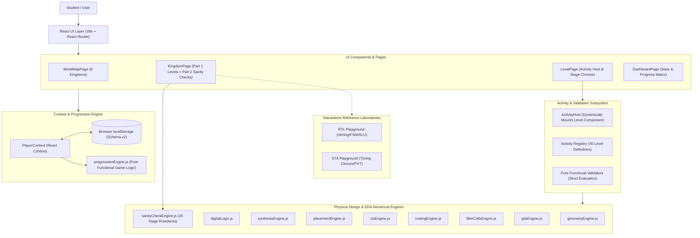
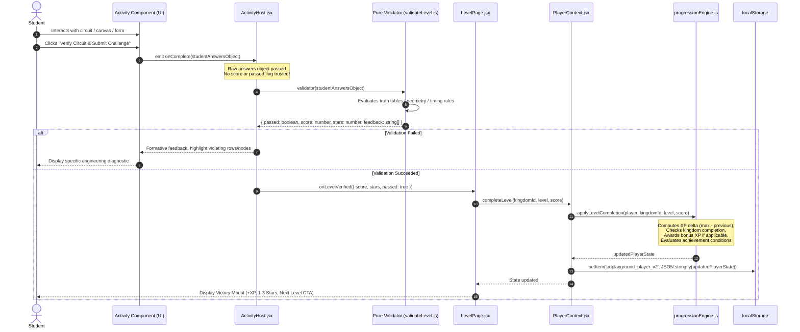
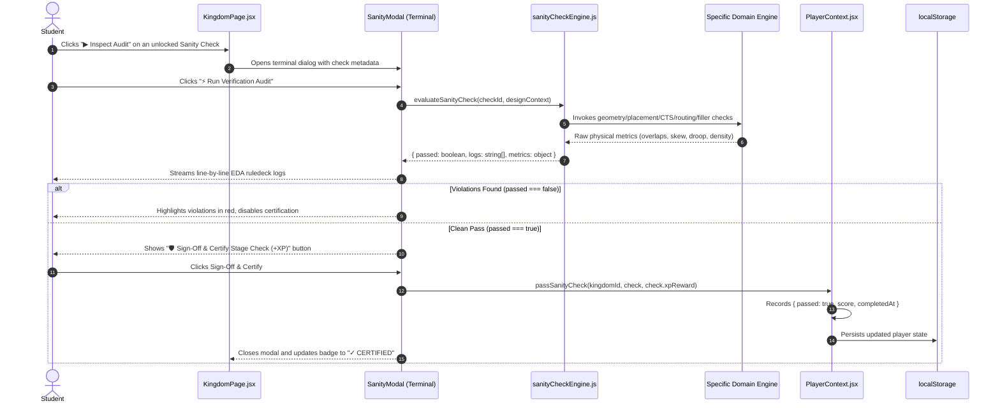

# ASIC Physical Design Playground — System Architecture & Component Design

This document details the software architecture, state lifecycle, component hierarchy, validation pipeline, and engine subsystem boundaries of PD Playground (`Game-Site`).

---

## 1. High-Level Architecture Overview

The PD Playground application is a single-page React application built with Vite that executes 100% locally in the student's browser with zero backend or external network dependencies.



---

## 2. Component Hierarchy & Page Structure

```
App.jsx (HashRouter / BrowserRouter)
│
├── Navbar.jsx (Global Branding, Avatar, Total XP Badge, Reset Option)
│
├── Routes:
│   ├── / -> LandingPage.jsx (Flow overview & quick resume)
│   │
│   ├── /world-map -> WorldMapPage.jsx
│   │   └── KingdomCard.jsx (x8 kingdoms: locked, available, completed)
│   │
│   ├── /kingdom/:kingdomId -> KingdomPage.jsx
│   │   ├── KingdomExternalLabCard (RTL Studio / STA Lab deep-links)
│   │   ├── Part 1: Core Concept Levels
│   │   │   └── LevelCard.jsx (x5 levels per kingdom: locked/available/done, star badges)
│   │   ├── Part 2: Stage Sanity Checks (Side Quests)
│   │   │   └── SanityCard.jsx (x3 to x9 audits: locked/available/certified)
│   │   └── SanityModal (Interactive EDA Sign-Off Terminal & Ruledeck Execution)
│   │
│   ├── /kingdom/:kingdomId/level/:levelId -> LevelPage.jsx
│   │   ├── ActivityHost.jsx (Dynamic level resolution via registry)
│   │   │   └── [Active Level Component, e.g. RTLMuxChallenge, FloorplanDieSetup, ...]
│   │   └── LevelCompletionModal (Star rating, XP award, return / next-level routing)
│   │
│   └── /dashboard -> DashboardPage.jsx
│       ├── StatCards (XP, Player Level, Kingdoms Unlocked, Levels Done, Sanity Checks)
│       ├── Overall Completion Progress Bar (Levels + Sanity Checks combined)
│       └── Per-Kingdom Progress Grid & Achievements Showcase
```

---

## 3. Pure Validation Pipeline & Reward Integrity

A core architectural principle of PD Playground is **complete decoupling of client UI from reward authorization**.

Students **cannot** receive XP or stars by manipulating UI sliders, passing client-side score payloads, or faking simulation timers.



---

## 4. Sanity Check Sign-Off Architecture

Sanity checks are organized into stage-specific audits that verify the physical integrity of the database created by completing the core levels.



---

## 5. Domain Engine Interfaces

The platform includes 9 domain engines organized as pure, stateless ES modules:

| Engine File | Primary Purpose | Key Exported Functions |
| :--- | :--- | :--- |
| `src/engine/geometryEngine.js` | Die/core calculations, aspect ratio, macro halos, rectangle overlap | `calculateDieAndCore`, `checkMacroHaloDRC`, `doBoxesOverlap`, `checkPinInCore` |
| `src/engine/digitalLogic.js` | Truth tables, 8-bit ripple adder/accumulator, signed overflow, FSM simulation | `simulateMux21`, `evaluateMuxTruthTable`, `simulate8BitAdder`, `simulateFSM` |
| `src/engine/synthesisEngine.js` | GTECH mapping, gate delay, boolean equivalence, power estimation | `mapLogicToStandardCells`, `estimateCombinationalDelay`, `verifyBooleanEquivalenceN`, `calculatePowerEstimate` |
| `src/engine/placementEngine.js` | Site snapping, weighted HPWL, GCell congestion heatmap, tap cell pitch | `snapToSiteGrid`, `computeWeightedHPWL`, `checkSiteAlignment`, `computeCongestionHeatmap`, `checkWellTapPitch` |
| `src/engine/ctsEngine.js` | Clock skew, setup/hold slack, clock buffer insertion, topology profiles | `calculateClockSkew`, `calculateSetupSlack`, `calculateHoldSlack`, `CLOCK_TOPOLOGY_PROFILES`, `balanceTwoSinks` |
| `src/engine/routingEngine.js` | Manhattan routing, sheet resistance, Elmore delay, DRC clearance | `computeManhattanDistance`, `computeWireResistance`, `computeElmoreDelay`, `checkRoutingShorts` |
| `src/engine/fillerCellsEngine.js` | Filler legalizer, row continuity, decap droop suppression, leakage penalty | `legalizeFillers`, `checkRowContinuity`, `calculateDecapDroop`, `PHYSICAL_ONLY_CELLS` |
| `src/engine/gdsEngine.js` | GDSII layer map, antenna ratio rule, CMP layer density, signoff checklist | `getStandardLayerMap`, `calculateAntennaRatio`, `checkCMPDensity`, `SIGNOFF_RULE_CHECKS` |
| `src/engine/sanityCheckEngine.js` | Evaluates all 26 stage sanity check ruledecks across the ASIC flow | `evaluateSanityCheck` |

---

## 6. Persistence Schema & Migration Architecture

### Schema Version 2 Structure
Stored under localStorage key `'pdplayground_player_v2'`:

```json
{
  "name": "ASIC Explorer",
  "avatarEmoji": "⚡",
  "totalXP": 320,
  "schemaVersion": 2,
  "levelProgress": {
    "rtl-1": {
      "completed": true,
      "xpEarned": 30,
      "stars": 3,
      "verified": true,
      "completedAt": "2026-11-04T18:22:00.000Z"
    }
  },
  "sanityCheckProgress": {
    "pl-legality": {
      "passed": true,
      "score": 20,
      "completedAt": "2026-11-04T18:22:15.000Z"
    }
  },
  "kingdomProgress": {
    "rtl-understanding": {
      "completed": true,
      "totalXP": 200
    }
  },
  "achievements": ["first-level", "truth-table-master", "rtl-master"],
  "lastPlayedAt": "2026-11-04T18:22:15.000Z"
}
```

### Automatic Migration
The storage loader (`src/context/PlayerContext.jsx` and `src/logic/storageMigration.js`) automatically inspects legacy `pdplayground_player_v1` data:
1. Detects schema version (missing or `schemaVersion < 2`).
2. Migrates level progress records, preserving stars and scores.
3. Initializes empty `sanityCheckProgress` map.
4. Recomputes total XP and unlocked kingdoms.
5. Saves the upgraded state to `pdplayground_player_v2`.
