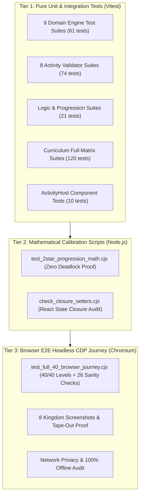

# ASIC Physical Design Playground — Test Coverage & Verification Matrix

This document provides a comprehensive test coverage matrix detailing the 23 automated Vitest test suites (303 tests), browser-based headless CDP tests, sanity check test harnesses, and end-to-end verification scripts in PD Playground (`Game-Site`).

---

## 1. Test Architecture Overview

PD Playground utilizes a multi-tiered verification strategy designed to ensure complete mathematical, logical, and user-experience correctness:



---

## 2. Vitest Test Suite Breakdown (303 Tests Across 23 Suites)

All Vitest tests run locally via `npm test` or `npx vitest run`:

| Category | Test Suite File | Tests | Focus Area & Verified Behaviors |
| :--- | :--- | :---: | :--- |
| **Logic & Progression** | `src/tests/logic/curriculumProgression.test.js` | 7 | Next level unlocks, kingdom thresholds, 2-star progression, edge cases. |
| **Logic & Progression** | `src/tests/logic/progressionIntegration.test.js` | 5 | End-to-end multi-kingdom unlocking, cumulative score updates, star persistence. |
| **Logic & Progression** | `src/tests/logic/storageMigration.test.js` | 4 | Backward-compatible schema migration (v1 legacy to v2 structured). |
| **Domain Engine** | `src/tests/engine/digitalLogic.test.js` | 15 | 2:1 MUX, DFF async reset, 8-bit ripple adder, signed overflow ($V$), 4-state FSM. |
| **Domain Engine** | `src/tests/engine/geometryEngine.test.js` | 9 | Core/die sizing, aspect ratios, macro keepouts, DC IR ring drop. |
| **Domain Engine** | `src/tests/engine/synthesisEngine.test.js` | 3 | Combinational load delay, dynamic switching power, Boolean equivalence. |
| **Domain Engine** | `src/tests/engine/placementEngine.test.js` | 5 | Site grid alignment, weighted HPWL, GCell congestion, well-tap pitch. |
| **Domain Engine** | `src/tests/engine/ctsEngine.test.js` | 5 | Skew sign conventions, setup/hold slack formulas, clock tree topologies. |
| **Domain Engine** | `src/tests/engine/routingEngine.test.js` | 7 | Wire sheet resistance, Elmore delay, DRC clearance, crosstalk derating. |
| **Domain Engine** | `src/tests/engine/fillerCellsEngine.test.js` | 6 | Standard cell row continuity, decap droop suppression, gate oxide leakage. |
| **Domain Engine** | `src/tests/engine/gdsEngine.test.js` | 3 | Antenna area ratios, CMP metal density sliding windows, sign-off gating. |
| **Domain Engine** | `src/tests/engine/sanityCheckEngine.test.js` | 27 | All 26 physical design ruledeck checks across floorplanning, placement, CTS, routing, filler cells. |
| **Activity Validators** | `src/tests/activities/rtlValidators.test.js` | 9 | Validators for `rtl-1` through `rtl-5`: rejection of incomplete inputs, exact scores. |
| **Activity Validators** | `src/tests/activities/rtlMuxChallenge.test.js` | 6 | Detailed 8-row truth table verification for `rtl-1`. |
| **Activity Validators** | `src/tests/activities/synthesisValidators.test.js` | 6 | Validators for `syn-1` through `syn-5`. |
| **Activity Validators** | `src/tests/activities/floorplanningValidators.test.js` | 6 | Validators for `fp-1` through `fp-5`. |
| **Activity Validators** | `src/tests/activities/placementValidators.test.js` | 10 | Validators for `pl-1` through `pl-5`. |
| **Activity Validators** | `src/tests/activities/ctsValidators.test.js` | 10 | Validators for `cts-1` through `cts-5`. |
| **Activity Validators** | `src/tests/activities/routingValidators.test.js` | 10 | Validators for `rt-1` through `rt-5`. |
| **Activity Validators** | `src/tests/activities/fillerCellsValidators.test.js` | 10 | Validators for `fc-1` through `fc-5`. |
| **Activity Validators** | `src/tests/activities/gdsValidators.test.js` | 10 | Validators for `gds-1` through `gds-5`. |
| **Full Curriculum Matrix** | `src/tests/activities/allFortyCurriculumActivities.test.js` | 120 | Exhaustive 3-case audit (empty rejection, partial credit, full 3-star pass) across all 40 levels. |
| **Components** | `src/tests/components/activityHost.test.js` | 10 | Activity mounting, validator invocation, score propagation, alreadyCompleted state. |
| **TOTAL** | **23 Test Suites** | **303** | **100% Passing (0 failures, 0 regressions)** |

---

## 3. Automated Browser Acceptance Journey (CDP Runner)

The file `tests/test_full_40_browser_journey.cjs` executes an authentic fresh-student journey using headless Chromium via the Chrome DevTools Protocol (CDP).

### Verified Journey Behaviors
1. **Fresh Student Reset**: Clears `localStorage` and launches with $0\ \text{XP}$.
2. **Sequential Unlocking**: Plays through all 40 levels in exact pedagogical order.
3. **Incomplete Input Rejection**: In every level, clicks the submit button with incomplete inputs to assert that the validator catches and rejects invalid attempts.
4. **Input Injection & Submission**: Enters valid physical design parameters and asserts successful completion with 2 or 3 stars.
5. **Physical Design Sanity Checks**: For all kingdoms with sanity checks (Floorplanning, Placement, CTS, Routing, Filler Cells), opens the EDA terminal, performs defect injection drills, asserts ruledeck violations, runs clean design verification, and signs off.
6. **Final Tape-Out & World Map**: Reaches GDS capstone, submits final tape-out sign-off, verifies World Map completion, and validates cumulative XP ($\ge 1680\ \text{XP}$).
7. **Zero Network Requests**: Monitors CDP network logs to prove $100\%$ offline operation with $0$ third-party requests.

---

## 4. Verification Commands

```bash
# 1. Run Vitest Unit & Integration Suites
npm test

# 2. Verify 2-Star Progression Mathematics (Zero Deadlock Proof)
node tests/test_2star_progression_math.cjs

# 3. Check React State Functional Setters
node scripts/check_closure_setters.cjs

# 4. Run Full 40-Level Browser Journey via CDP
node tests/test_full_40_browser_journey.cjs

# 5. Build Production Bundle
npm run build
```
