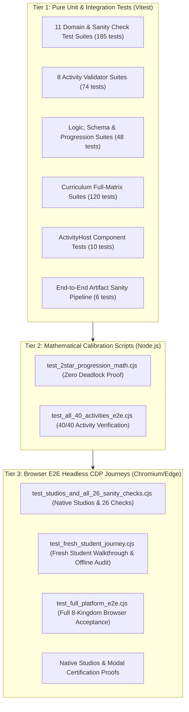

# ASIC Physical Design Playground — Test Coverage & Verification Matrix

This document provides a comprehensive test coverage matrix detailing the **28 automated Vitest test suites (443 tests)**, browser-based headless CDP tests, sanity check test harnesses, and end-to-end verification scripts in PD Playground (`Game-Site`).

---

## 1. Test Architecture Overview

PD Playground utilizes a multi-tiered verification strategy designed to ensure complete mathematical, logical, and user-experience correctness:

---

## 2. Vitest Test Suite Breakdown (443 Tests Across 28 Suites)

All Vitest tests run locally via `npm test` or `cmd /c "npm test -- --run"`:

| Category | Test Suite File | Tests | Focus Area & Verified Behaviors |
| :--- | :--- | :---: | :--- |
| **Integrity Regressions** | `src/tests/engine/certificationIntegrityRegressions.test.js` | 5 | P0 fail-closed reproduction: missing artifacts, empty designs, practice-only isolation, non-blocking progression, non-negative coordinates. |
| **Artifact Contracts** | `src/tests/logic/designArtifactContracts.test.js` | 11 | Versioned envelope creation, schema validation, `NaN`/`Infinity` rejection, negative geometry checks, placement cell coordinate validation. |
| **Logic & Progression** | `src/tests/logic/curriculumProgression.test.js` | 7 | Next level unlocks, kingdom thresholds, 2-star progression, edge cases. |
| **Logic & Progression** | `src/tests/logic/progressionIntegration.test.js` | 5 | End-to-end multi-kingdom unlocking, cumulative score updates, star persistence. |
| **Logic & Progression** | `src/tests/logic/storageMigration.test.js` | 4 | Backward-compatible schema migration (v1 legacy to v2 structured). |
| **Logic & Progression** | `src/tests/logic/studentDesignContext.test.js` | 7 | Prerequisite mapping, artifact extraction across all 26 checks, 15 certifiable vs 11 practice-only classification. |
| **Domain Engine** | `src/tests/engine/digitalLogic.test.js` | 15 | 2:1 MUX, DFF async reset, 8-bit ripple adder, signed overflow ($V$), 4-state FSM. |
| **Domain Engine** | `src/tests/engine/geometryEngine.test.js` | 9 | Core/die sizing, aspect ratios, macro keepouts, DC IR ring drop. |
| **Domain Engine** | `src/tests/engine/synthesisEngine.test.js` | 3 | Combinational load delay, dynamic switching power, Boolean equivalence. |
| **Domain Engine** | `src/tests/engine/placementEngine.test.js` | 5 | Site grid alignment, weighted HPWL, GCell congestion, well-tap pitch. |
| **Domain Engine** | `src/tests/engine/ctsEngine.test.js` | 5 | Skew sign conventions, setup/hold slack formulas, clock tree topologies. |
| **Domain Engine** | `src/tests/engine/routingEngine.test.js` | 7 | Wire sheet resistance, Elmore delay, DRC clearance, crosstalk derating. |
| **Domain Engine** | `src/tests/engine/fillerCellsEngine.test.js` | 6 | Standard cell row continuity, decap droop suppression, gate oxide leakage. |
| **Domain Engine** | `src/tests/engine/gdsEngine.test.js` | 3 | Antenna area ratios, CMP metal density sliding windows, sign-off gating. |
| **Domain Engine** | `src/tests/engine/sanityCheckEngine.test.js` | 32 | All 26 physical design ruledeck checks, defect injection tolerance, student vs demo modes. |
| **Domain Engine** | `src/tests/engine/all26SanityChecksIndividual.test.js` | 106 | **Comprehensive 26-Check Matrix**: Evaluates every single sanity check across missing-prerequisite rejection (26), demo certification isolation (26), demo defect injection (26), valid student design sign-off (15 certifiable + 11 practice). |
| **End-to-End Pipeline** | `src/tests/engine/endToEndArtifactSanityPipeline.test.js` | 6 | E2E integration: level completion emits artifacts, sanity checks verify measurements, certifiable checks grant sign-off, practice checks remain isolated. |
| **Activity Validators** | `src/tests/activities/rtlValidators.test.js` | 9 | Validators for `rtl-1` through `rtl-5`: rejection of incomplete inputs, exact scores. |
| **Activity Validators** | `src/tests/activities/rtlMuxChallenge.test.js` | 6 | Detailed 8-row truth table verification for `rtl-1`. |
| **Activity Validators** | `src/tests/activities/synthesisValidators.test.js` | 6 | Validators for `syn-1` through `syn-5`. |
| **Activity Validators** | `src/tests/activities/floorplanningValidators.test.js` | 6 | Validators for `fp-1` through `fp-5`. |
| **Activity Validators** | `src/tests/activities/placementValidators.test.js` | 10 | Validators for `pl-1` through `pl-5`. |
| **Activity Validators** | `src/tests/activities/ctsValidators.test.js` | 10 | Validators for `cts-1` through `cts-5`. |
| **Activity Validators** | `src/tests/activities/routingValidators.test.js` | 10 | Validators for `rt-1` through `rt-5`. |
| **Activity Validators** | `src/tests/activities/fillerCellsValidators.test.js` | 10 | Validators for `fc-1` through `fc-5`. |
| **Activity Validators** | `src/tests/activities/gdsValidators.test.js` | 10 | Validators for `gds-1` through `gds-5`. |
| **Curriculum Full-Matrix** | `src/tests/activities/allFortyCurriculumActivities.test.js` | 120 | Full 40-level test battery: evaluates valid inputs, invalid/empty inputs, and boundary scores. |
| **UI Component** | `src/tests/components/activityHost.test.js` | 10 | ActivityHost mounting, score calculation, star dispatch, and retry workflows. |
| **TOTAL** | **28 Test Suites** | **443 Tests** | **100% Passing (Execution duration: ~1.30s)** |

---

## 3. Dedicated 26 Sanity Check Verification Matrix

Every physical design sanity check is tested across four distinct lifecycle conditions:
1. **Missing Prerequisite Rejection**: Verifies that when a student has not completed the prerequisite level(s), `canCertify` is `false`, audit terminates with `passed: false`, and clear prerequisite violation logs are issued.
2. **Demonstration Certification Isolation**: Verifies that in Demonstration Mode (`isStudentDesign: false`), `isDemonstration` is `true` and `canCertify` is `false` (guaranteeing that practice fault drills never award certification XP).
3. **Fault Injection Detection**: Verifies that when intentional physical defects are injected in demonstration mode, the ruledeck detects the fault and fails (`passed: false`).
4. **Student Design Sign-Off**: Exactly 15 certifiable checks award +25 XP upon passing student measurements; exactly 11 practice-only checks complete practice drills with 0 XP.

| Sanity Check ID | Stage | Classification | Prerequisite Levels | Key Verified Parameter |
| :--- | :--- | :--- | :--- | :--- |
| `fp-drc` | Floorplanning | **CERTIFIABLE** | `fp-4`, `fp-5` | Core boundary margin (>= 20 µm) & macro halo (>= 15 µm) |
| `fp-connectivity` | Floorplanning | **PRACTICE ONLY** | `fp-5` | Closed-loop VDD/VSS power ring continuity fault drill |
| `fp-missing-vias` | Floorplanning | **PRACTICE ONLY** | `fp-5` | Orthogonal power mesh via cut completeness drill |
| `pl-legality` | Placement | **CERTIFIABLE** | `pl-2`, `pl-5` | Site row grid alignment & zero cell active area overlap |
| `pl-congestion` | Placement | **CERTIFIABLE** | `pl-4` | GCell 2D routing demand overflow ($D/C \le 1.0$) |
| `pl-drc` | Placement | **PRACTICE ONLY** | `pl-5` | Latchup well-tap spacing demonstration drill |
| `pl-connectivity` | Placement | **PRACTICE ONLY** | `pl-5` | Standard cell logical signal net pin connection drill |
| `pl-missing-vias` | Placement | **CERTIFIABLE** | `pl-5` | Cell power pin rail snap & 0 off-rail cells |
| `cts-clock-tree-report`| CTS | **CERTIFIABLE** | `cts-5` | Clock arrival variance across sinks ($\text{skew} \le 50$ ps) |
| `cts-timing-reports` | CTS | **CERTIFIABLE** | `cts-2` | Setup & hold slack margins with real clock skew |
| `cts-power` | CTS | **CERTIFIABLE** | `cts-3`, `cts-5` | Clock tree buffer switching power budget ($\le 5.0$ mW) |
| `cts-qor` | CTS | **PRACTICE ONLY** | `cts-5` | Maximum clock transition slew drill ($\le 80$ ps) |
| `rt-lvs` | Routing | **CERTIFIABLE** | `rt-5` | Physical interconnect vs netlist electrical shorts |
| `rt-design` | Routing | **CERTIFIABLE** | `rt-3` | Via layer enclosure ($\ge 0.010$ µm) & metal pitch DRC |
| `rt-constraints` | Routing | **CERTIFIABLE** | `rt-4` | Signal integrity crosstalk glitch noise ($\le 50$ mV) |
| `rt-routes` | Routing | **PRACTICE ONLY** | `rt-5` | Detailed route track continuity & open net drill |
| `rt-timing` | Routing | **PRACTICE ONLY** | `rt-5` | Post-route distributed SPEF RC timing slack drill |
| `fc-legality` | Filler Cells | **CERTIFIABLE** | `fc-5` | Standard cell row site alignment & discrete cell snapping |
| `fc-drc` | Filler Cells | **CERTIFIABLE** | `fc-5` | Continuous N-well & 100% standard cell row void filling |
| `fc-connectivity` | Filler Cells | **CERTIFIABLE** | `fc-3` | VDD/VSS rail abutment & substrate well bias |
| `fc-constraints` | Filler Cells | **CERTIFIABLE** | `fc-4` | Dynamic power rail droop suppression ($\le 40$ mV) |
| `fc-power` | Filler Cells | **CERTIFIABLE** | `fc-4` | Decap dynamic droop suppression vs gate tunneling leakage |
| `fc-design` | Filler Cells | **PRACTICE ONLY** | `fc-5` | CMP poly and metal layer density window drill |
| `fc-timing` | Filler Cells | **PRACTICE ONLY** | `fc-5` | Post-filler parasitic capacitance loading drill |
| `fc-qor` | Filler Cells | **PRACTICE ONLY** | `fc-5` | Sign-off QoR composite scorecard drill |
| `fc-congestion` | Filler Cells | **PRACTICE ONLY** | `fc-5` | Filler pin access availability & non-blocking upper metals drill |

---

## 4. Browser E2E Headless CDP Acceptance Suites

### 1. `tests/test_studios_and_all_26_sanity_checks.cjs`
- **Scope**: Headless Chromium/Edge E2E verification using Chrome DevTools Protocol.
- **Key Assertions**:
  1. Route `/studio/rtl` mounts and loads the complete 24-lesson RTL studio from `/studios/rtl/index.html` with zero external network requests.
  2. Route `/studio/sta` mounts and loads the Static Timing Analysis studio from `/studios/sta/index.html` with zero external network requests.
  3. Strict architectural disclosure verified on both studio pages.
  4. Sanity check modal rejects unearned certification when student design prerequisites are incomplete.
  5. Demonstration fault drill runs with simulated defect injection, detects defect, and blocks certification XP (`canCertify: false`).
  6. Nominal demonstration drill completes with `Practice Drill Complete` and zero certification XP.
  7. Genuine student design audit certifies and awards XP when student layout geometry is present.
  8. All 26 sanity checks active and rendered across the 5 physical design kingdoms.

### 2. `tests/test_fresh_student_journey.cjs`
- **Scope**: Real student progression walkthrough starting from clean `localStorage`, progressing through Kingdom 1 level-by-level, verifying unlocked gates, and validating complete local storage persistence across browser reload.

### 3. `tests/test_full_platform_e2e.cjs`
- **Scope**: Comprehensive full-platform verification iterating across all 8 ASIC Kingdoms, verifying 0 performance sliders, checking that interactive activities mount properly, executing interactive sanity check verification terminals, and completing challenges.
